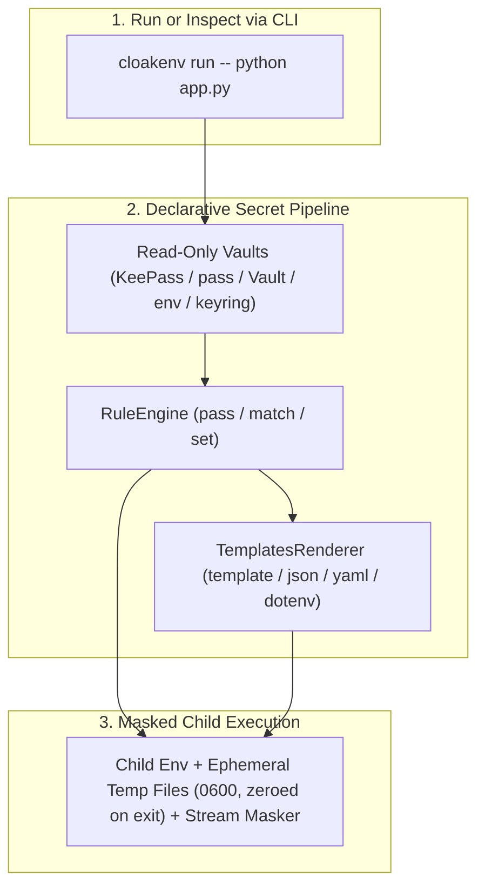

# cloakenv

[](https://goreportcard.com/report/github.com/warpcode/cloakenv)
[](LICENSE)

**Pluggable secret orchestrator and declarative runtime environment injector.**

`cloakenv` eliminates plaintext secret sprawl. Instead of writing credentials to unencrypted `.env` files or exposing secrets via raw CLI getters, `cloakenv` reads entries from pure read-only backends (KeePass, `pass`, HashiCorp Vault, OS Keyring, process environment, and encrypted cache), transforms them declaratively through `envs:` and `templates:` pipelines, masks secrets in child process output, and delivers them strictly for child command execution.

---

## Table of Contents

- [Why cloakenv?](#why-cloakenv)
- [How It Works](#how-it-works)
- [Prerequisites](#prerequisites)
- [Installation](#installation)
- [Quick Start](#quick-start)
- [Core Concepts](#core-concepts)
  - [Read-Only Vaults & Flat `Entry` Model](#read-only-vaults--flat-entry-model)
  - [Declarative `envs:` & `RuleEngine` (`pass`, `match`, `set`)](#declarative-envs--ruleengine-pass-match-set)
  - [Declarative `templates:` & Delivery](#declarative-templates--delivery)
- [CLI Command Reference](#cli-command-reference)
  - [`run` — Execute Commands with Autoloaded Secrets](#run--execute-commands-with-autoloaded-secrets)
  - [`inspect` — Preview Resolved Envs & Templates (`<REDACTED>`)](#inspect--preview-resolved-envs--templates-redacted)
  - [`auth` — Manage Vault Authentication](#auth--manage-vault-authentication)
  - [`cache` — Local Encrypted Cache Management](#cache--local-encrypted-cache-management)
  - [`doctor` — Diagnose Environment & Config](#doctor--diagnose-environment--config)
  - [`completion` — Generate Shell Autocompletion Scripts](#completion--generate-shell-autocompletion-scripts)
  - [`version` — Print Build & Runtime Version](#version--print-build--runtime-version)
  - [`internal` — Developer & Hook Helpers](#internal--developer--hook-helpers)
- [Secret Providers](#secret-providers)
  - [KeePass (`keepass`)](#keepass-keepass)
  - [Password Store (`pass`)](#password-store-pass)
  - [HashiCorp Vault (`vault`)](#hashicorp-vault-vault)
  - [Process Environment (`env`)](#process-environment-env)
  - [OS Keyring (`keyring`)](#os-keyring-keyring)
  - [Transparent Per-Vault Caching (`cache`)](#transparent-per-vault-caching-cache)
- [Pure Go Template Functions Reference](#pure-go-template-functions-reference)
- [Command Autoloading & Ephemeral File Delivery](#command-autoloading--ephemeral-file-delivery)
- [Configuration Reference (`config.yaml`)](#configuration-reference-configyaml)
- [Headless & CI/CD Usage](#headless--cicd-usage)
- [Development & Testing](#development--testing)
- [License](#license)

---

## Why cloakenv?

- **Zero-Leak CLI**: `cloakenv` never prints raw secrets to stdout—there are no `get`, `show`, `search`, `set`, `delete`, or `sync` commands. `cloakenv inspect` unconditionally emits `<REDACTED>` for every secret value.
- **Declarative Config Governance**: All filtering, key renaming, formatting, and templated file generation live inside `config.yaml` under `envs:`, `templates:`, and `autoload:`.
- **Stream Masking & Ephemeral Cleanup**: Child process stdout/stderr is scrubbed via an Aho-Corasick masking trie (`MaskingWriter`), and ephemeral template files prefer `/dev/shm` (`0700` dirs / `0600` files, `O_NOFOLLOW`) and are zero-filled and unlinked on exit.
- **Cross-Platform**: Supported on Linux, macOS, and Windows.

---

## How It Works



---

## Prerequisites

- [Go](https://go.dev/) 1.26.6 or higher.
- A supported operating system credential store:
  - **macOS**: Keychain (built-in)
  - **Linux**: D-Bus Secret Service (`gnome-keyring`, `ksecretsservice`, or `keepassxc`)
  - **Windows**: Windows Credential Manager (built-in)

---

## Installation

### Using `go install` (Recommended)

```bash
go install github.com/warpcode/cloakenv@latest
```

### Direct Execution with `go run`

```bash
go run github.com/warpcode/cloakenv@latest --help
```

### Building from Source

```bash
git clone https://github.com/warpcode/cloakenv.git
cd cloakenv
make build
# Binary is compiled to bin/cloakenv
```

### Pre-compiled Binaries & Cryptographic Verification

Pre-compiled release archives (`.tar.gz` for Linux/macOS and `.zip` for Windows) are available on the [Releases](https://github.com/warpcode/cloakenv/releases) page.

Every release artifact includes a `checksums.txt` file, cryptographic keyless signature bundles (`.sigstore.json`) signed by Sigstore/Cosign via GitHub Actions OIDC, and verifiable SLSA Level 3 build provenance attestations.

#### 1. Verify `checksums.txt` with Cosign

```bash
# Keyless verification using the self-contained Sigstore bundle
cosign verify-blob \
  --bundle checksums.txt.sigstore.json \
  --certificate-identity-regexp "^https://github.com/warpcode/cloakenv/" \
  --certificate-oidc-issuer "https://token.actions.githubusercontent.com" \
  checksums.txt
```

#### 2. Verify Archive Checksum

```bash
sha256sum --ignore-missing -c checksums.txt
```

#### 3. Verify SLSA Level 3 Provenance with GitHub CLI

```bash
gh attestation verify cloakenv-linux-amd64.tar.gz --owner warpcode
```

---

## Quick Start

1. Declare your read-only vault, environment rule set, and command binding in `~/.config/cloakenv/config.yaml`:

```yaml
vaults:
  work:
    provider: keepass
    vault_path: ~/secrets/work.kdbx

envs:
  app_env:
    - vault: work
      query: '{{ eq .title "OpenAI" }}'
      rules:
        - type: pass
          include: ["API_KEY"]
          key_format: env

autoload:
  - match: "^python app\\.py$"
    envs:
      - app_env
```

2. Authenticate your KeePass database once in the OS keyring:

```bash
cloakenv auth login work
```

3. Safely audit resolved variable names and delivery targets without exposing secrets:

```bash
cloakenv inspect run -- python app.py
```

4. Run the command with in-memory secret injection and automatic stream masking:

```bash
cloakenv run -- python app.py
```

---

## Core Concepts

### Read-Only Vaults & Flat `Entry` Model

Every vault provider is strictly read-only and returns flat `Entry` maps containing raw secret attributes alongside canonical lowercase metadata keys:

- `title` — Entry title
- `path` — Canonical entry path within the vault
- `uuid` — Entry identifier (where supported)
- `tags` — List of tags (case-preserved; matched dynamically by `hasTag`)
- `group` — Group metadata map (`name`, `path`, `uuid`) when present

`env` and `keyring` are implicitly available by name without needing `vaults:` blocks, or can be explicitly declared to scope keys with `query:`.

### Declarative `envs:` & `RuleEngine` (`pass`, `match`, `set`)

Each named environment under `envs:` is an ordered list of vault sources (`vault`, optional Go `text/template` `query:` predicate, and ordered `rules:`).

- **`type: pass`**: Copies entry attributes matching optional `include` globs while excluding `exclude` globs (`exclude` overrides `include`), formatting keys with `key_format` (`none`, `env`, `snake`, `kebab`). Reserved metadata keys (`title`, `path`, `uuid`, `tags`, `group`, `vault`, `provider`) are never emitted by wildcards.
- **`type: match`**: Matches attribute key regex (`match`) and/or serialized value regex (`value_match`), and renders target `key` and `value` using Go `text/template` (with `$1` / `${1}` capture expansions evaluated safely before template parsing).
- **`type: set`**: Evaluates a map of `values:` templates (`key: template`) with access to `.output` and entry fields, overwriting keys with last-rule-wins semantics.

### Declarative `templates:` & Delivery

Named templates under `templates:` produce structured payloads or hydrated files using four built-in drivers:

- **`template`** (default when `template:` or `path:` is set, or scalar shorthand): Executes a Go `text/template` with `.entries` (the list of rule-transformed entry maps).
- **`json`**: Serializes the resolved entries (`[]map[string]string` from `vaults:` rules) as JSON.
- **`yaml`**: Serializes the resolved entries (`[]map[string]string` from `vaults:` rules) as YAML.
- **`dotenv`**: Emits `KEY="VALUE"` lines from `vaults:` rules or `from_env:` with safe escaping (`$` and backticks escaped) and validates key names.

---

## CLI Command Reference

Global flags available before subcommands:
- `-c <config_path>` — Load an alternate configuration file (default: `~/.config/cloakenv/config.yaml`)
- `-h, --help` — Display help information
- `-v, --version` — Print version information

### `run` — Execute Commands with Autoloaded Secrets

```bash
cloakenv [-c config_path] run [-E] [--no-autoload] [--dry-run] -- <command> [args]
```

**Flags:**
- `-E` — Start with an empty environment (do not inherit parent process environment)
- `--no-autoload` — Disable command autoloading rules for this execution
- `--dry-run` — Preview resolved environment keys, templates (redacted), and command without executing

### `inspect` — Preview Resolved Envs & Templates (`<REDACTED>`)

```bash
cloakenv [-c config_path] inspect [-o text|json|yaml]
cloakenv [-c config_path] inspect env <name> [-o text|json|yaml]
cloakenv [-c config_path] inspect template <name> [-o text|json|yaml]
cloakenv [-c config_path] inspect [-o text|json|yaml] run -- <command> [args]
```

Evaluates queries, `RuleEngine` transforms, template drivers, and autoload matching to preview matched entry metadata, generated variable names, and delivery targets. All resolved secret values are unconditionally replaced with `<REDACTED>`.

**Flags:**
- `-o, --output <format>` — Output format: `text` (default), `json`, or `yaml`

### `auth` — Manage Vault Authentication

```bash
cloakenv [-c config_path] auth login <vault>
cloakenv [-c config_path] auth forget <vault>
cloakenv [-c config_path] auth status [vault] [-o text|json|yaml]
```

Prompts securely (or reads from stdin) to save vault unlock credentials in the OS keyring (`login`), remove stored credentials (`forget`), or check vault unlock and connection readiness (`status`).

### `cache` — Local Encrypted Cache Management

```bash
cloakenv [-c config_path] cache clear
cloakenv [-c config_path] cache prune
```

Clears all cached vault entries or prunes expired cache records from the encrypted local cache.

### `doctor` — Diagnose Environment & Config

```bash
cloakenv [-c config_path] doctor [--strict]
```

Validates `config.yaml` schema, template syntax and function signatures, autoload regexes, stale ephemeral files, keyring availability, and vault reachability (`--strict` treats warnings as errors).

### `completion` — Generate Shell Autocompletion Scripts

```bash
cloakenv completion <bash|zsh|fish|powershell>
```

### `version` — Print Build & Runtime Version

```bash
cloakenv version
```

### `internal` — Developer & Hook Helpers

```bash
cloakenv [-c config_path] internal match-alias -- <command> [args]
cloakenv [-c config_path] internal list-vaults
```

Used by shell integration hooks to inspect alias matches and configured vault names.

---

## Secret Providers

All providers implement pure read-only retrieval via `provider.SecretProvider` and `provider.SearchableProvider`:

### KeePass (`keepass`)

```yaml
vaults:
  work:
    provider: keepass
    vault_path: ~/secrets/work.kdbx
    key_file: ~/secrets/work.keyx        # optional key file
    key_file_env: WORK_KEEPASS_KEYFILE   # optional env var holding key file path
    resolve_references: false            # enable KeePass {REF:...} expansion
```

Exposes entry attributes (including `Password` and lowercase `password`), attachments, and canonical metadata (`title`, `path`, `uuid`, `tags`, `group`). Supports optional `query:` to prefilter KeePass group/entry paths.

### Password Store (`pass`)

```yaml
vaults:
  pass_store:
    provider: pass
    vault_path: ~/.password-store
    query: work/
```

Decrypts GPG-encrypted `.gpg` entries via `pass`/`gpg`, exposing the first line as `password`/`Password` and structured `Key: Value` lines as flat attributes. Supports optional `query:` to scope lookups to a subdirectory or entry prefix.

### HashiCorp Vault (`vault`)

```yaml
vaults:
  hcp_vault:
    provider: vault
    address: https://vault.example.com:8200
    mount_path: secret
    engine_version: 2       # 1 or 2 (default 2)
    namespace: admin        # optional Enterprise namespace
    query: prod/
```

Supports KV v1 and KV v2 with token (`token` / `VAULT_TOKEN`) or AppRole (`role_id`/`secret_id` or `VAULT_ROLE_ID`/`VAULT_SECRET_ID`) authentication.

### Process Environment (`env`)

```yaml
vaults:
  local_env:
    provider: env
```

Available implicitly as `vault: env` (or explicitly configured under `vaults:`). Returns a single flat `Entry` containing current process environment variables; use `rules:` with explicit `include:` globs (for example, `include: ["AWS_*"]`) to select specific variables.

### OS Keyring (`keyring`)

```yaml
vaults:
  os_secrets:
    provider: keyring
    query: "OPENAI_API_KEY,ANTHROPIC_API_KEY"
```

Available implicitly as `vault: keyring` or configured explicitly with `provider: keyring` and `query:` key names. Non-enumerable OS keyring backends require explicit key names via `query:`. Internal cloakenv cache and provider master keys (`cache_token`, `cache_disk_token`, `cache-master-key`, `provider/*`, `cache/*`, `cache_v2/*`) are strictly isolated and blocked from flat entry lookups.

### Transparent Per-Vault Caching (`cache`)

```yaml
vaults:
  work:
    provider: keepass
    vault_path: ~/secrets/work.kdbx
    cache:
      enabled: true       # or shorthand: `cache: true` or `cache: "15m"`
      ttl: "15m"
      mode: "keyring"     # "keyring" (default) or "encrypted_disk"
```

---

## Pure Go Template Functions Reference

All template expressions compile with `.Option("missingkey=error")` and accept only pure functions validated statically by `config.Validate` / `cloakenv doctor`:

- **Tag & Fallback Helpers**:
  - `hasTag "prod" .tags` — Case-insensitive tag membership test
  - `default <fallback> <val...>` — Returns first non-empty value or fallback
  - `coalesce <val...>` — Returns first non-empty string representation
- **Serialization & Formatting**:
  - `toEnv` / `toKv` — Formats a map (`map[string]any` or `map[string]string`) as sorted `KEY=VALUE` lines, skipping reserved metadata keys
  - `toJSON` / `toJson` / `json` — Serializes value to compact JSON
  - `fromJSON` / `fromJson` — Parses JSON string
  - `toYAML` / `toYaml` / `yaml` — Serializes value to YAML
  - `fromYAML` / `fromYaml` — Parses YAML string
- **Key & String Transforms**:
  - `upper`, `lower` — Uppercase / lowercase string
  - `env` — Formats key as `UPPER_SNAKE_CASE`
  - `snake` — Formats key as `lower_snake_case`
  - `kebab` — Formats key as `lower-kebab-case`
  - `keys` — Returns sorted key slice for a map (`map[string]any` or `map[string]string`)
  - `values` — Returns values ordered by sorted keys for a map
  - `join <sep> <slice>` — Joins string or any slices
  - `shquote` / `shellQuote` — POSIX single-quote escapes a string

Legacy URI/file/command template functions (`get`, `tryGet`, `entry`, `search`, `include`, `includeFile`, `exec`) are permanently removed.

---

## Command Autoloading & Ephemeral File Delivery

`autoload:` binds shell commands executed via `cloakenv run -- <cmd>` to declarative `envs:` and `templates:`:

```yaml
autoload:
  - match: "^deploy\\s+(.*)$"
    command: "./scripts/deploy.sh \\1"
    envs:
      - prod_env
      - DEPLOY_ENV: "production"
    templates:
      - template: service_json
        env_path: SERVICE_CONFIG_PATH
        persist: false
```

- `envs[]` items accept named `envs:` keys or inline `KEY: VALUE` maps (values may reference previously resolved variables via pure Go templates).
- `templates[]` deliveries support:
  - `env`: Export rendered content directly into an environment variable
  - `env_path`: Write rendered content to a secure `0600` file (preferring `/dev/shm` when `path` is omitted), export its path in the target variable, and zero + unlink on exit unless `persist: true`
  - `path`: Explicit destination path (supports templates, checked against symlinks and pre-existing files unless safe creation applies)

---

## Configuration Reference (`config.yaml`)

See [`examples/config.yaml`](examples/config.yaml) for a complete, validated configuration example covering `cache`, `keyring`, `audit`, `vaults`, `envs`, `templates`, and `autoload`.

---

## Headless & CI/CD Usage

1. Supply credentials via process environment (`vault: env` with `pass` `include:` globs) or Vault AppRole (`role_id`/`secret_id` or `VAULT_TOKEN`).
2. Bind CI deployment commands via `autoload:` and execute with `cloakenv run -- ./deploy.sh` (or `--dry-run` / `cloakenv inspect` in CI sanity checks).
3. Set `audit.enabled: true` when non-secret access telemetry (`jsonl` or `json`) is required.

---

## Development & Testing

### Common Makefile Targets

```bash
make build         # Compile binary to bin/cloakenv
make run           # Run application via go run .
make test          # Run tests with race detector (go test -v -race ./...)
make bench         # Run performance benchmarks
make fmt           # Format Go source code (go fmt ./...)
make vet           # Run Go static analysis (go vet ./...)
make lint          # Run static analysis with golangci-lint (golangci-lint run)
make test-all      # Run fmt, vet, test, and bench in sequence
make clean         # Remove build artifacts (bin/)
make install       # Install binary to $GOBIN or $GOPATH/bin
make uninstall     # Remove installed binary
make verify        # Run complete verification: build, vet, format check, race tests
make agents-check  # Run automated documentation & repository consistency checks
```

### Running Test Verification with Test Fixture

See [`testdata/README.md`](testdata/README.md) for KeePass fixture details (`testdata/testDB.kdbx`).

```bash
make verify lint agents-check
```

---

## License

MIT License. See [LICENSE](LICENSE) for details.
