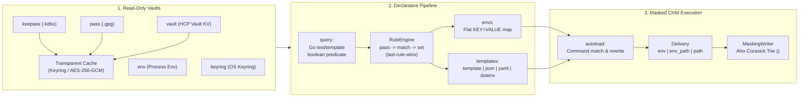

# cloakenv Documentation

Welcome to the official documentation for **`cloakenv`**, a declarative, zero-leak secret orchestrator and dynamic runtime environment injector written in Go.

`cloakenv` eliminates plaintext `.env` sprawl and prevents credential exfiltration by reading from pure read-only secret vaults, transforming entries through a declarative pipeline, masking secret values in child process output, and delivering secrets strictly in memory or ephemeral `0600` files that are zeroed and unlinked on exit.

---

## Architecture Overview

---

## Documentation Map

### Getting Started
| Guide | Description |
|---|---|
| [Installation](getting-started/installation.md) | Prerequisites, OS credential stores, installation methods, Cosign/SLSA verification, and shell completions |
| [Quick Start](getting-started/quickstart.md) | 5-minute walkthrough from `config.yaml` creation to `auth`, `doctor`, `inspect`, and `run` |
| [Core Concepts](getting-started/core-concepts.md) | Pure read-only vaults, flat `Entry` model, `RuleEngine`, `envs:` vs `templates:`, and zero-leak boundary |

### Secret Providers
| Guide | Description |
|---|---|
| [Providers Overview](providers/README.md) | Provider comparison matrix, multi-entry vs flat K/V topology, and canonical `Entry` metadata |
| [KeePass (`keepass`)](providers/keepass.md) | `.kdbx` configuration, OS keyring unlock, key files, and `{REF:...}` reference resolution |
| [Password Store (`pass`)](providers/pass.md) | GPG `.gpg` store configuration, subdirectory scoping, and `Key: Value` / `tags:` parsing |
| [HashiCorp Vault (`vault`)](providers/vault.md) | KV v1/v2 engines, Token & AppRole authentication, Enterprise namespaces, and path scoping |
| [Process Environment (`env`)](providers/env.md) | Implicit and explicit `env` vault usage, glob filtering, and value-regex matching |
| [OS Keyring (`keyring`)](providers/keyring.md) | Native Keychain/Secret Service/Credential Manager, `query:` key lists, and internal key isolation |
| [Transparent Caching (`cache`)](providers/caching.md) | Per-vault caching (`keyring` vs `encrypted_disk` AES-256-GCM), TTLs, `cache prune`, and `cache clear` |

### Declarative Transformation Pipeline
| Guide | Description |
|---|---|
| [Pipeline Overview](pipeline/README.md) | End-to-end execution order, deterministic sorting, and trace architecture |
| [Entry Queries (`query:`)](pipeline/queries.md) | Provider-native scopes vs Go `text/template` boolean predicates and missing-key behavior |
| [Transformation Rules (`rules:`)](pipeline/rules.md) | Ordered `pass`, `match`, and `set` rules, capture groups, `.output`, and reserved key protection |
| [Environment Sets (`envs:`)](pipeline/envs.md) | Multi-vault environment composition and deterministic last-entry-wins precedence |
| [Template Generators (`templates:`)](pipeline/templates.md) | Rendering structured payloads with `template`, `json`, `yaml`, and `dotenv` drivers |
| [Template Functions Reference](pipeline/template-functions.md) | Complete reference for all built-in Go `text/template` helpers (`hasTag`, `toEnv`, `toJSON`, `env`, `shquote`, etc.) |

### Command Execution & Delivery
| Guide | Description |
|---|---|
| [Command Autoloading (`autoload:`)](execution/autoload.md) | Regex/wildcard command matching, capture group rewriting (`command:`), and inline env overrides |
| [Ephemeral Template Delivery](execution/template-delivery.md) | All 4 delivery modes (`env`, `env_path`, `env_path+path`, `path`), `/dev/shm`, `persist`, and zero-on-exit |
| [Stream Output Masking](execution/stream-masking.md) | Real-time Aho-Corasick `MaskTrie` redaction across child `stdout` and `stderr` |

### CLI & Security
| Guide | Description |
|---|---|
| [CLI Command Reference](cli/README.md) | Complete reference for `run`, `inspect`, `auth`, `cache`, `doctor`, `completion`, `version`, and `internal` |
| [Threat Model & Security Guarantees](security/threat-model.md) | Zero-leak policy boundary, memory scrubbing, symlink/overwrite guards, and supply-chain security |
| [Structured Audit Logging](security/audit-logging.md) | Non-secret JSON/JSONL access telemetry (`audit.jsonl`) configuration and event schema |

### Usage Guides & Cookbooks
| Guide | Description |
|---|---|
| [AI Agents & LiteLLM Proxy](guides/ai-agents-and-litellm.md) | Running LiteLLM, Claude Code, Aider, and Python LLM apps with masked output and ephemeral configs |
| [Cloud, Kubernetes & Terraform](guides/cloud-and-kubernetes.md) | Injecting `AWS_*` credentials, ephemeral `KUBECONFIG`, `TF_VAR_*`, and Docker Compose `.env` |
| [Shell Integration & Auto-Wrapping](guides/shell-integration.md) | Zsh, Bash, and Fish hooks using `cloakenv internal match-alias` and shell completions |
| [Headless & CI/CD Usage](guides/cicd-and-headless.md) | Non-interactive authentication, AppRole, isolated `-c` configs, and CI validation gates |
| [Troubleshooting & Diagnostics](guides/troubleshooting.md) | Resolving template errors, keyring/D-Bus issues, symlink guards, and stale ephemeral files |

### Reference & Architecture
| Document | Description |
|---|---|
| [Configuration Schema Reference](reference/config-schema.md) | Complete field-by-field specification for `config.yaml` |
| [Migration Guide (to ADR-0003)](reference/migration-guide.md) | Upgrading legacy `vaults:` keys, `expr-lang` queries, and retired CLI commands |
| [Architecture Decision Records](adr/README.md) | Design decisions and supersession history (`ADR-0001` – `ADR-0003`) |
| [Technical Plans](plans/README.md) | Feature implementation specifications and status |

---

## Core Primitives at a Glance

| Primitive | Purpose | Output Shape | Key Features |
|---|---|---|---|
| **`vaults:`** | Read-only secret backends | `[]Entry` (`map[string]any`) | `keepass`, `pass`, `vault`, `env`, `keyring`, transparent `cache:` |
| **`envs:`** | Flat environment variable sets | `map[string]string` | Multi-vault composition, `query:` predicates, `pass`/`match`/`set` rules |
| **`templates:`** | Structured payloads & config files | Rendered string | `template`, `json`, `yaml`, `dotenv` drivers, `missingkey=error` |
| **`autoload:`** | Command-to-secret bindings | Child env + temp files | Regex/glob matching, command rewriting, `env`/`env_path`/`path` delivery |
