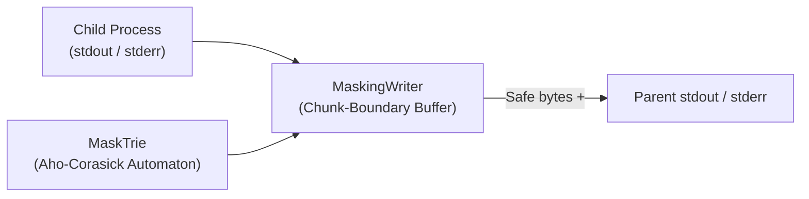

# Stream Output Masking

When executing a child command via `cloakenv run -- <command>`, `cloakenv` supervises the child process and scrubs both `stdout` and `stderr` in real time so secrets cannot leak into terminal logs or AI agent transcripts.

---

## How `MaskTrie` & `MaskingWriter` Work

1. **Secret Collection**:
   Before launching the child process, `EnvBuilder` collects all non-empty values to mask:
   - Every variable value resolved from `autoload[].envs[]`
   - Full rendered content of every `autoload[].templates[]`
   - Every individual post-rule field value inside each rendered template's `.entries`
2. **Minimum Length Filter (`minMaskSecretLen = 4`)**:
   Values shorter than 4 bytes or consisting solely of whitespace are excluded from the trie so common values like `"0"`, `"1"`, `"yes"`, or `"no"` do not corrupt ordinary command output.
3. **Aho-Corasick Multi-Pattern Automaton**:
   `NewMaskTrie` compiles all qualifying secrets into a deterministic prefix trie with failure links (`internal/runner/masker.go`), enabling linear-time $O(N)$ scanning regardless of how many secrets are loaded.
4. **Chunk-Boundary Lookahead**:
   If a child process writes a secret split across multiple `write()` syscalls (for example, `"sk-live-"` followed by `"12345"`), `MaskingWriter` uses `extendableDepth` to hold only the potentially matching suffix in its internal buffer until either the match completes (emitting `<REDACTED>`) or diverges (flushing the safe prefix). Any remaining buffered bytes are flushed when the child exits.

---

## Dry-Run & Inspect Redaction

- **`cloakenv inspect`**: Unconditionally replaces all secret values with `<REDACTED>` and masks any resolved template `path:` values containing secrets.
- **`cloakenv run --dry-run`**: Masks both the previewed command line and any templated file paths through `MaskTrie` before printing.
