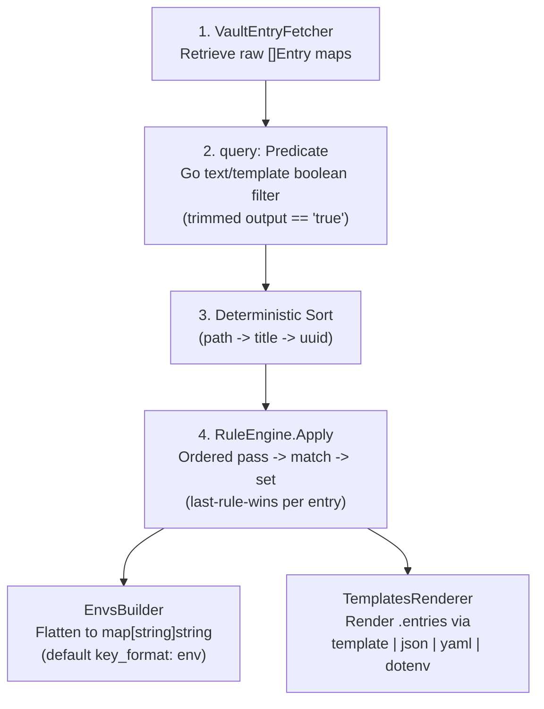

# Declarative Transformation Pipeline

`cloakenv` separates raw secret retrieval (`vaults:`) from projection and formatting (`envs:` and `templates:`). Every vault source inside `envs:` or `templates:` executes the same deterministic four-stage pipeline:

---

## Key Pipeline Guarantees

1. **Deterministic Ordering**: Matched entries within a source are always sorted by `(path, title, uuid)`. Multi-source `envs:` and `templates:` evaluate sources in list order.
2. **Non-Mutating Source Entries**: `RuleEngine` never mutates raw `Entry` maps in place, allowing the same vault entry to be projected differently by multiple `envs:` and `templates:`.
3. **Fail-Closed Templates**: All Go `text/template` expressions compile with `.Option("missingkey=error")` so typos in field names fail immediately instead of silently rendering `<no value>`.
4. **Secret-Free Tracing**: Every transformation records `RuleTrace` (`RuleIndex`, `RuleType`, `KeysAdded`) without recording secret values, powering `cloakenv inspect`.

---

## Pipeline Guides

- [Entry Queries (`query:`)](queries.md) — Selecting entries with Go `text/template` predicates
- [Transformation Rules (`rules:`)](rules.md) — Filtering, regex mapping, and templating with `pass`, `match`, and `set`
- [Environment Sets (`envs:`)](envs.md) — Composing flat environment variable maps
- [Template Generators (`templates:`)](templates.md) — Generating files and payloads with `template`, `json`, `yaml`, and `dotenv`
- [Template Functions Reference](template-functions.md) — All built-in Go `text/template` helpers
